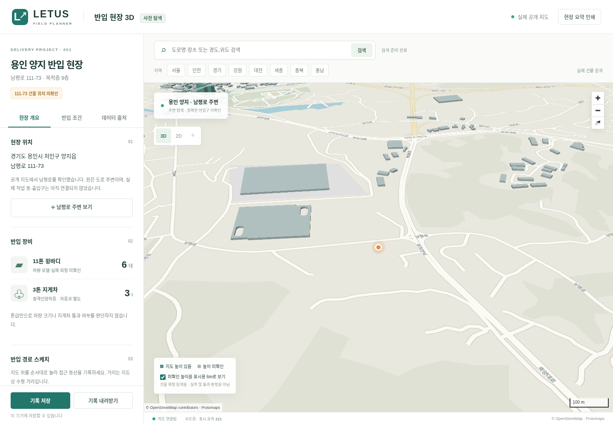

# 실행본 · 2026-11-09

[웹으로 열기 (외부 뷰어)](https://raw.githack.com/a1556jack/3D-Simulation-for-B2B-Furniture-installation-in-LETUS/1158a83c1274fe0ab884cd65c3ab0cd3dd01b0c8/release/LETUS-3D.html)

[HTML 실행본 다운로드](https://github.com/a1556jack/3D-Simulation-for-B2B-Furniture-installation-in-LETUS/raw/1158a83c1274fe0ab884cd65c3ab0cd3dd01b0c8/release/LETUS-3D.html)

최신 실행본은 출처별 25종 반입 조건 기록, 확인된 높이·폭 비교, 파일 병합·복구를 포함합니다. 전체 반입 통과나 E/V 탑승 판정을 제공하는 완성형 검사기는 아닙니다. [남은 데이터·구현](REMAINING.md).

실행본은 약 16MB이며 인터넷 연결이 필요합니다. 데이터 다운로드는 원본 공개 지도에 직접 연결합니다. 웹 뷰어 자체는 현재 클라우드의 네트워크 정책으로 접속 검증하지 못했습니다. 동일 HTML의 HTTP 실행과 지도 요청은 Chromium에서 검증했습니다. GitHub 원본 다운로드는 HTTP 200과 파일 해시 일치를 확인했습니다.

- Published app commit: `1158a83c1274fe0ab884cd65c3ab0cd3dd01b0c8` on `work`.
- HTML SHA-256: `f1c3efe61fa693870d00a33fce079daff03b37f252fe6d9cadd94a59156176c5`.
- No GitHub Pages deployment or third-party API approval is claimed.
- Pilot address `111-73` is still not linked to an exact building; the view shows real Nampeong-ro vicinity. Nine-floor interiors and delivery clearances remain unverified.

Map data © OpenStreetMap contributors · Protomaps. [출처·범위](SOURCES.md) · [검증 기록](VERIFICATION.md).
