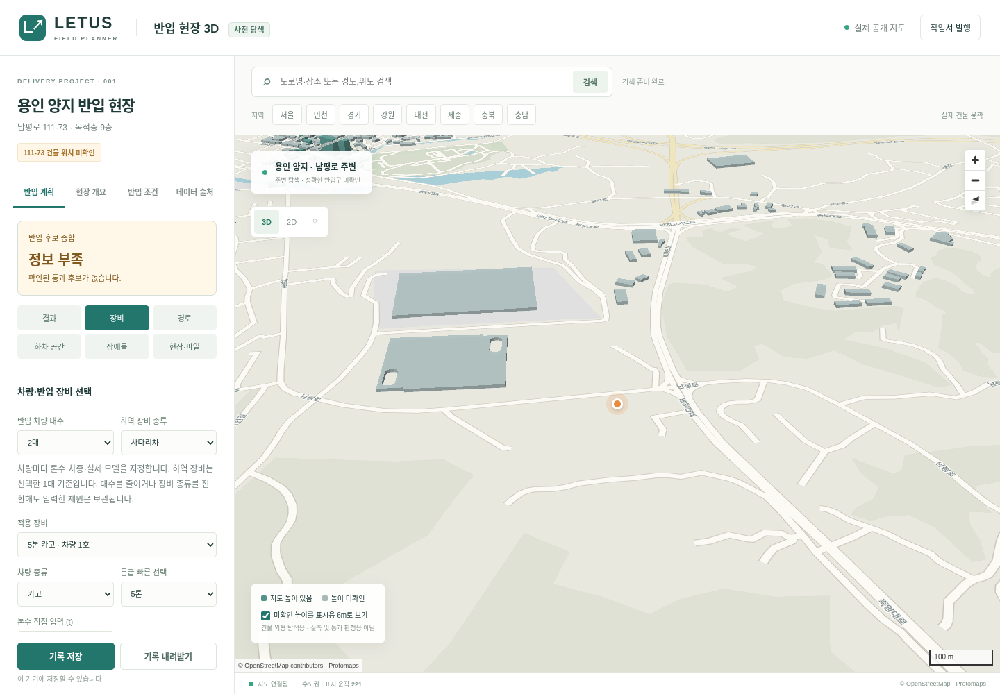
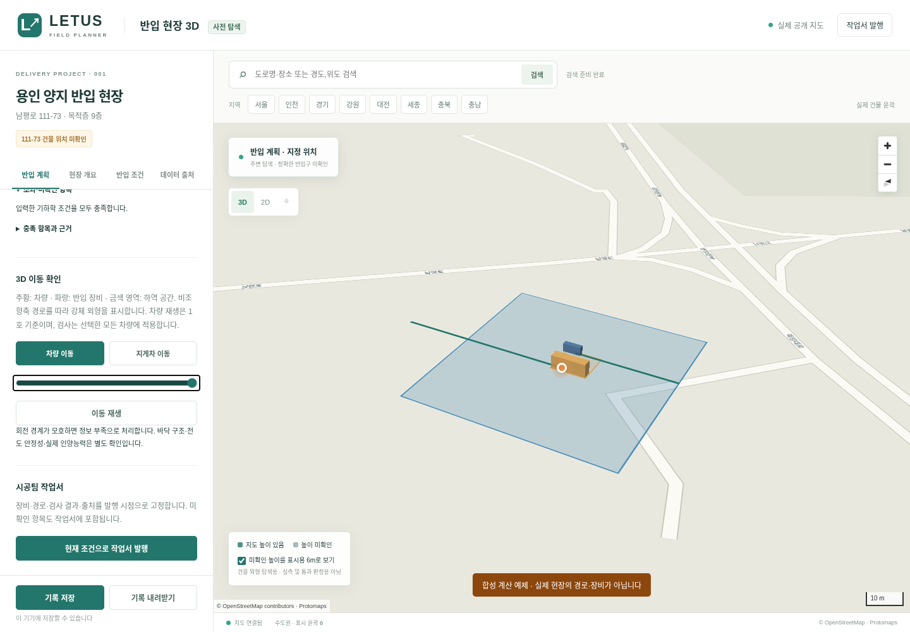

# 실행본 · 2026-11-09

[웹으로 열기 (외부 뷰어)](https://raw.githack.com/a1556jack/3D-Simulation-for-B2B-Furniture-installation-in-LETUS/9bde11c61c78b76f9f89736fc99a33cd22bd52d0/release/LETUS-3D.html)

[HTML 실행본 다운로드](https://github.com/a1556jack/3D-Simulation-for-B2B-Furniture-installation-in-LETUS/raw/9bde11c61c78b76f9f89736fc99a33cd22bd52d0/release/LETUS-3D.html)

최신 실행본은 차량 1~20대의 톤수·차종(윙바디/탑차/카고), 지게차·사다리차·기타 장비 선택을 지원합니다. 반입 경로와 하차 공간 후보를 입력하면 구간별 기하학적 간섭을 비교하고, 확인된 통과 후보만 추천합니다. 3D 이동 외형, 위험 위치, 조건을 고정한 작업서와 PDF 인쇄가 포함됩니다. 사다리차는 설치 공간과 작업 높이·거리·하중 조건을 검토합니다. 실제 현장 미확인 정보는 정보 부족으로 남으며 E/V 탑승은 판정하지 않습니다. [남은 데이터·구현](REMAINING.md).

실행본은 약 16MB이며 인터넷 연결이 필요합니다. 데이터 다운로드는 원본 공개 지도에 직접 연결합니다. 웹 뷰어 자체는 현재 클라우드의 네트워크 정책으로 접속 검증하지 못했습니다. 동일 HTML의 HTTP 실행과 지도 요청은 Chromium에서 검증했습니다. GitHub 원본 다운로드는 HTTP 200과 파일 해시 일치를 확인했습니다.

- Published app commit: `9bde11c61c78b76f9f89736fc99a33cd22bd52d0` on `work`.
- HTML SHA-256: `2889f650d97c43229c4a18c63fa790832c45a03dbc382f758cb2cee05d320ff8`.
- No GitHub Pages deployment or third-party API approval is claimed.
- Pilot address `111-73` is still not linked to an exact building; the view shows real Nampeong-ro vicinity. Nine-floor interiors and delivery clearances remain unverified.

`반입 계획 → 장비`에서 선택하세요. 초기값은 기존 요청의 11톤 윙바디 6대 + 3톤 지게차이며 자유롭게 변경할 수 있습니다. 데이터가 없는 실제 현장 대신 계산 흐름을 보려면 `합성 예제로 기능 확인`을 누르세요. 예제는 실제 현장과 별도로 보관됩니다.

Map data © OpenStreetMap contributors · Protomaps. [출처·범위](SOURCES.md) · [검증 기록](VERIFICATION.md).
