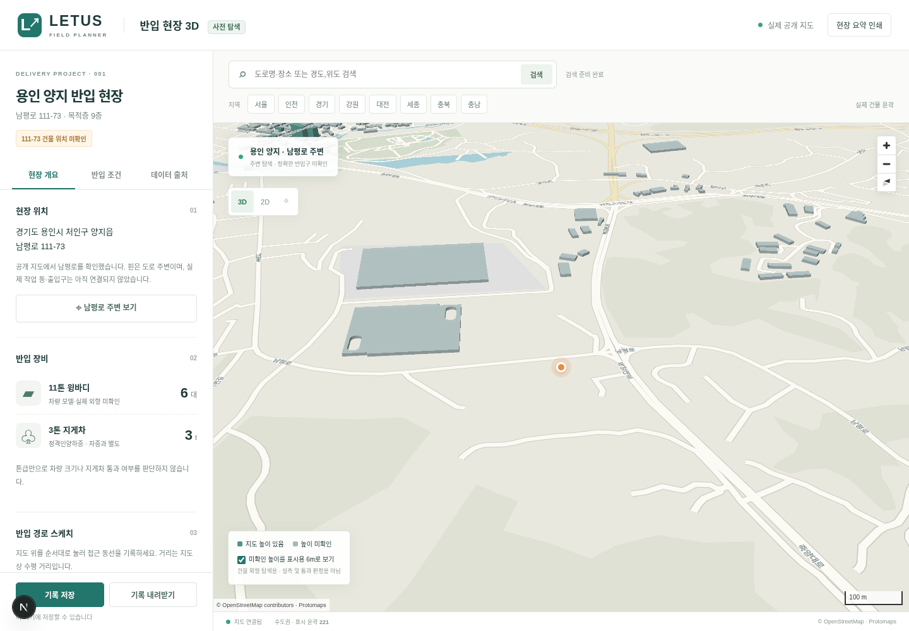
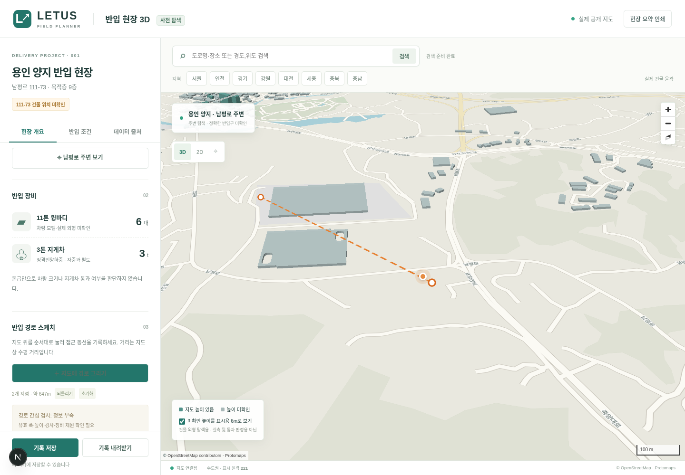
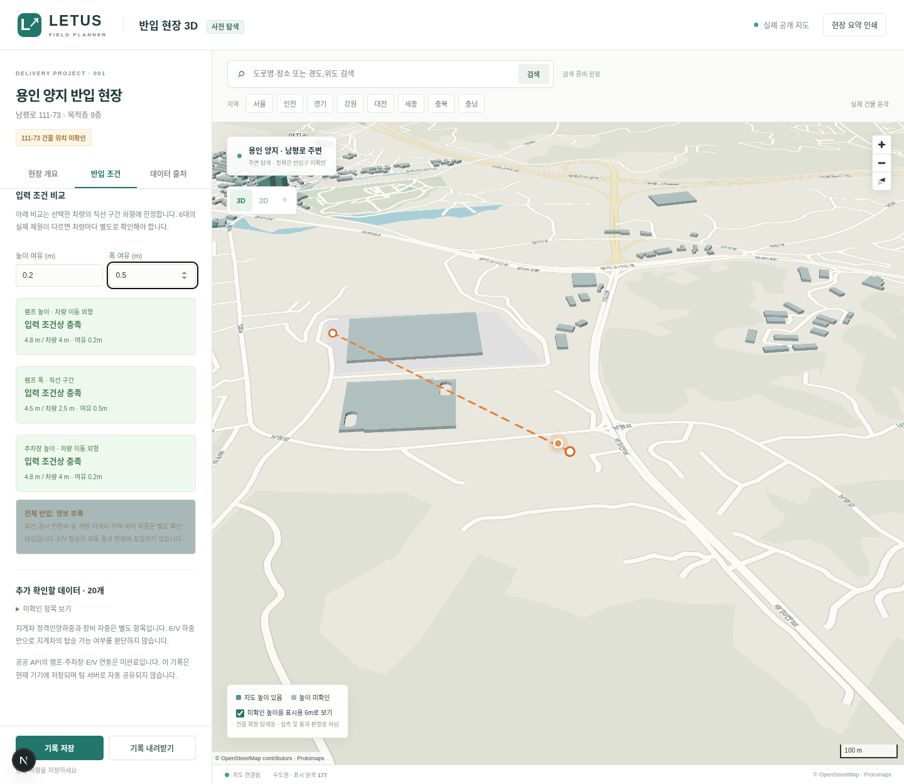
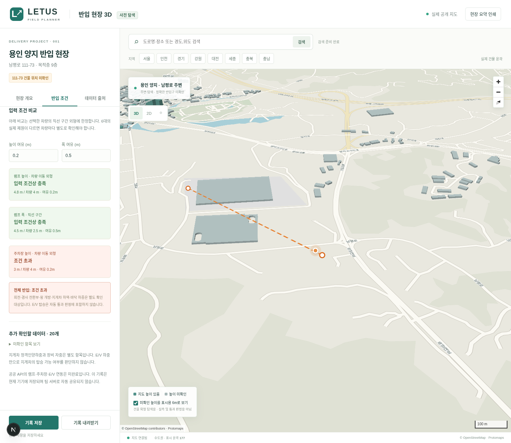
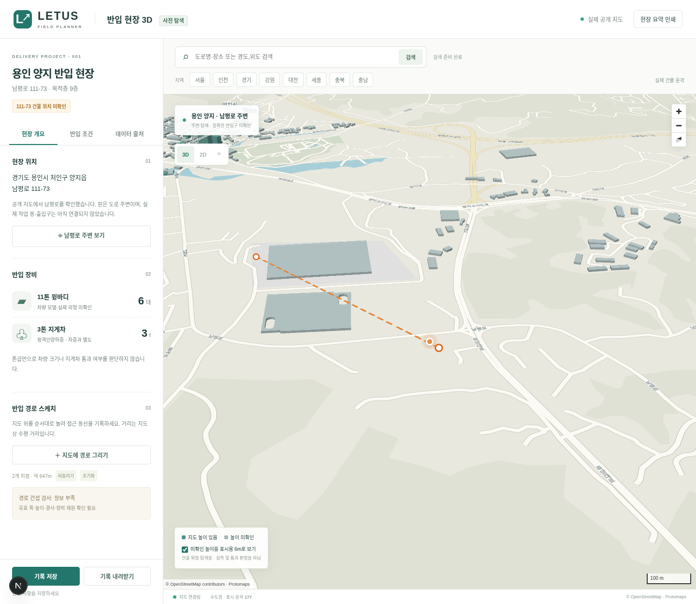

# 반입 의사결정 기능 점검

점검일: 2026-11-09 (한국 시간). 대상: `aca40d0b0d74f50ed89773c7b2bf4a6d74230458`의 현재 앱. 현재 소스를 로컬 HTTP로 실행하고 Chromium에서 새로운 브라우저 세션으로 점검했다. 외부 공개 URL의 동작을 다시 검증한 결과는 아니다.

## 결론

현재 앱은 지역 건물 윤곽 탐색, 수동 동선 기록, 출처별 조건 기록, 세 가지 직선 치수 비교를 제공한다. 사용자가 원하는 **실제 반입 가능 여부, 추천 반입로, 추천 차량 하차 공간을 결정하는 기능은 충족하지 못한다.**

데이터가 없는 것 외에 계산과 추천 로직 자체가 없다. 공공 API 연결만으로 해결되지 않는다. 기록 25종 중 자동 비교에 사용하는 항목은 램프 높이·폭, 주차장 높이, 차량 높이·폭의 5종이다. 나머지 조건은 현재 기록과 미확인 목록에만 쓰인다.

## 기능별 판단

| 요구 기능 | 현재 동작 | 실무상 빠진 결과 |
| --- | --- | --- |
| 반입 가능 여부 | 램프 높이·직선 폭, 주차장 높이 비교 3개 | 경로 구간별 판정, 회전·돌출·경사 전환·장애물 간섭, 실패 위치·이유 |
| 추천 반입로 | 클릭 좌표를 직선으로 연결하고 수평 거리 표시 | 도로/통로 연결 관계, 차량 통행 제한, 후보 경로 비교, 추천 근거 |
| 추천 하차 공간 | 폭·길이를 수동으로 기록 | 지도상 하차 영역, 차량 배치 방향, 윙 개방 및 지게차 작업 공간, 후보 비교 |
| 11톤 윙바디 6대 | 화면 문구와 내보내기에 대수 표시; 차량 치수는 공용 한 세트 | 차량별 실제 제원, 차량별 적용 경로, 동시 정차·대기 가능 대수 |
| 3톤 지게차 | 정격하중·자중·치수·적재물 기록 | 이동 궤적, 마스트 및 적재물 외형, 차량과의 간섭, 하역 시 배치 |
| 남평로 111-73·9층 | 남평로 주변 표시, 9층은 목적층 문구 | 정확한 동·출입구 연결, 하차 지점에서 E/V 앞까지의 실제 경로 |
| 시공팀 전달 | 로컬 저장, JSON 내보내기, 현재 화면 인쇄 | 검사 결과가 고정된 작업서, 위험 지점 이미지, 작업 배정·공유 |

## 화면에서 재현한 순서

아래 수치는 모두 **기능 점검용 합성값**이다. 현장 실측이나 실제 장비 제원으로 등록하거나 공유하지 않았다. 별도 브라우저에서 점검했고 기존 사용자 기록을 변경하지 않았다.

### 1. 현장 개요 — 부분 동작

실제 지도는 표시되지만 정확한 건물·출입구가 연결되지 않았다. 차량·지게차 카드에서 모델 선택이나 공간 배치를 할 수 없다. 화면 자체에는 미확인 상태가 명시돼 있다.

### 2. 경로 스케치 — 기록만 동작, 검사·추천 없음

지도에서 두 점을 찍자 건물 윤곽을 가로지르는 약 647m의 직선이 표시됐다. 경로는 도로에 맞춰지지 않았고 장애물 교차 경고도 없었다. 이는 현재 스케치 기능의 동작이며, 통행 가능한 경로 생성으로 사용할 수 없다.

### 3. 충분한 직선 치수 입력 — 제한된 비교만 동작

램프 높이 4.8m, 폭 4.5m, 주차장 높이 4.8m, 차량 높이 4m·폭 2.5m를 출처·확인일과 함께 입력하고 확인했다. 높이 여유 0.2m, 폭 여유 0.5m에서 세 비교는 모두 충족으로 표시됐다. 전체 결과는 정보 부족이었다. 전체 검사가 없는 현재 구조에서 이 제한은 타당하며, 전체 통과로 강제로 바꾸면 안 된다.

### 4. 명확한 높이 초과 입력 — 조건 화면의 실패 판정 동작

주차장 높이만 3m로 바꾸고 새 기록을 선택했다. 차량 높이 4m에 대해 주차장 비교와 전체 반입이 모두 ‘조건 초과’로 표시됐다. 화면에 표시되는 실패를 확인했다.

### 5. 개요로 돌아가고 기록 내보내기 — 결과 연결 오류

같은 세션에서 현장 개요로 돌아가면 ‘경로 간섭 검사: 정보 부족’이 그대로 표시된다. 조건 화면의 확인된 실패가 요약에 전달되지 않는다. JSON 내보내기에도 계산 결과가 없고 `routeStatus`는 고정 문구다. 관측값은 내보내지만 판정 결과를 전달하는 작업서는 아니다.

## 코드로 확인한 원인

- `src/lib/observations.ts:103`: `checkInspection(store)`은 세 치수 비교만 수행한다. 경로 좌표나 장애물, 하차 영역을 입력받지 않는다. 실패가 없으면 전체 결과를 항상 `unknown`으로 둔다.
- `src/components/map-canvas.tsx:14`: 경로는 좌표 배열의 GeoJSON `LineString`이다. 통로 연결이나 차량 조향을 계산하지 않는다.
- `src/components/workspace.tsx:58`: 현장 개요의 경로 판정은 고정 문자열이다. 조건 화면의 `checkInspection` 결과와 연결되지 않는다.
- `src/components/workspace.tsx:47`: 내보내기에 관측값과 스케치는 포함되지만 계산된 검사 결과와 버전은 없다.
- `src/lib/observations.ts:36`: 관측값 선택은 현장과 항목 단위다. 경로 구간 ID·하차 후보 ID·차량 ID가 없어 여러 통로와 6대의 서로 다른 제원을 구분해 적용할 수 없다.
- `src/components/workspace.tsx:49`: 인쇄는 `window.print()`이다. 고정 버전 작업서 생성기가 아니며 현재 선택한 탭의 내용을 출력한다.

## 우선 보완할 사항과 인수 기준

1. **화면·내보내기의 판정 일치.** 같은 조건의 확인된 실패가 조건 탭, 현장 개요, 지도 위험 표시, 출력물에 같은 이유로 나타나야 한다. 현재 세 비교의 결과와 아직 구현하지 않은 경로 검사를 구분해서 표시한다.
2. **경로·장비·하차 공간의 데이터 구조.** 출입구, 구간, 장애물, 하차 영역을 좌표와 치수로 정의하고 관측값을 각 대상에 연결한다. 차량 6대를 모델/실제 제원별로 구분한다. 정확한 현장 연결이 없으면 후보 또는 검토 대상으로 표시한다.
3. **구간별 반입 검사.** 지정 경로에 실제 차량·지게차 외형을 적용해 직선, 회전, 후진, 상부 장애물, 램프 전환부를 검사한다. 얇은 장애물도 이동 중 놓치지 않고 위치·원인을 표시해야 한다. 치수를 바꾸면 해당 구간 결과가 재계산돼야 한다.
4. **하차 공간 후보 비교.** 측면/후면 하역, 윙·리프트 전개, 지게차 작업 영역, 출입구까지 연결을 비교한다. 후보마다 통과 조건, 막히는 이유, 부족한 확인값을 보여준다. 6대가 모두 정차 가능한지와 순차 반입이 필요한지를 공간 조건으로 구분한다. 인력·배차 시간 최적화까지 확대할 필요는 없다.
5. **반입 경로 후보 비교와 추천.** 검증된 연결 구간으로 경로 후보를 만들고 통행 제한·간섭·현장 운영조건을 확인한다. 추천 근거와 확인되지 않은 조건을 함께 제시한다. 지도상 빈 땅이나 짧은 직선이라는 이유만으로 사용 가능한 공간/경로로 추천하지 않는다. 초기 계획에서 제외했던 자동 최적 경로 탐색과 이번에 요청한 후보 비교·추천은 구현 범위를 명시해 구분한다.
6. **시공팀 작업서.** 선택한 경로·하차 공간, 적용 장비, 검사 결과, 추가 실측 항목, 출처·확인일을 하나의 버전으로 고정한다. 현장 조건 변경 시 이전 결과가 오래됐음을 표시한다.

## UX·접근성 관찰 및 한계

- 장점: 모르는 주소·높이·제원을 확인된 값으로 표시하지 않고, 조건 비교에 출처와 확인을 요구한다.
- 문제: 지도는 화면 대부분을 차지하지만 실무 결과는 긴 조건 목록 아래에 있다. 여러 입력 항목이 실제 검사에 사용되지 않는다는 사실도 입력 단계에서 충분히 구분되지 않는다.
- 화면 3의 정보 부족 카드에는 작은 글씨와 낮아 보이는 명도 대비가 있다. CSS의 전역 `.unknown{background:#a8b8b8}`가 범례 외 결과 카드에도 적용된다. 이번 점검에서는 색 대비 수치나 WCAG 준수 여부를 확정하지 않았다.
- 마우스 지도 클릭 방식의 키보드 대체 입력은 UI에서 확인되지 않았다. 보조기기 전체 사용성 및 모바일 현장 흐름은 이번 재현 범위에 포함하지 않았다.
- 이번에는 지도 연결, 수동 스케치, 세 조건 충족, 조건 초과, 요약·내보내기 불일치를 직접 재현했다. 브라우저 JavaScript 오류는 없었다. 기존 44개 테스트는 지도·입력·저장 등 구현된 범위의 검증이며, 추천·전체 간섭 검사 완성의 근거가 아니다.
- E/V 탑승, 바닥 구조 안전, 지게차 전도 및 실제 인양능력 자동 판정은 원래 제외 범위다. 위 누락된 기하학적 검사와 구분해야 한다.

이번 변경은 점검 보고서와 증거 보관이다. 실행 코드, 현장값, 게시된 프로그램은 변경하지 않았다.
